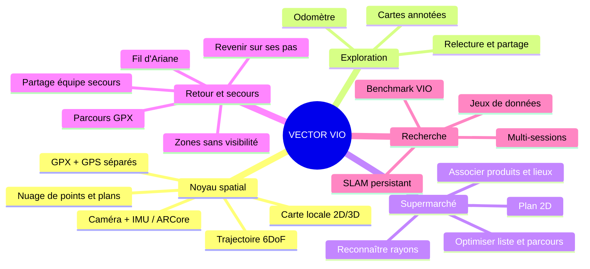
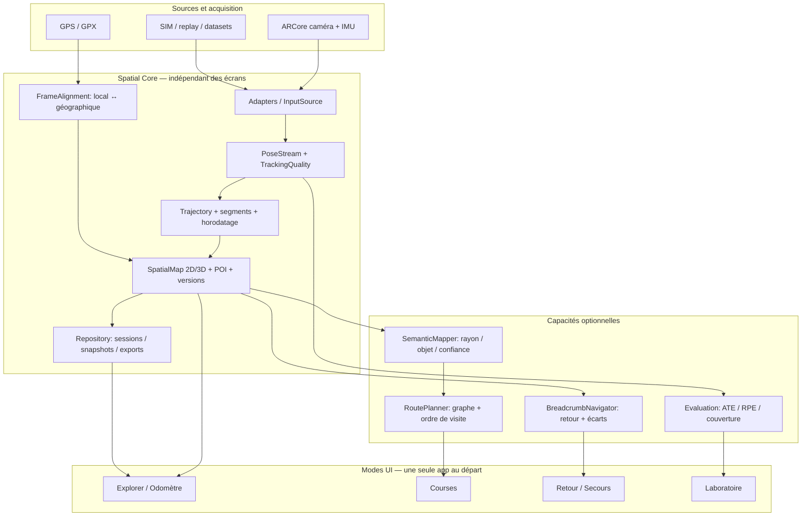
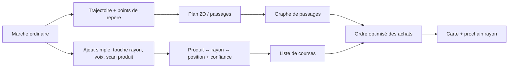
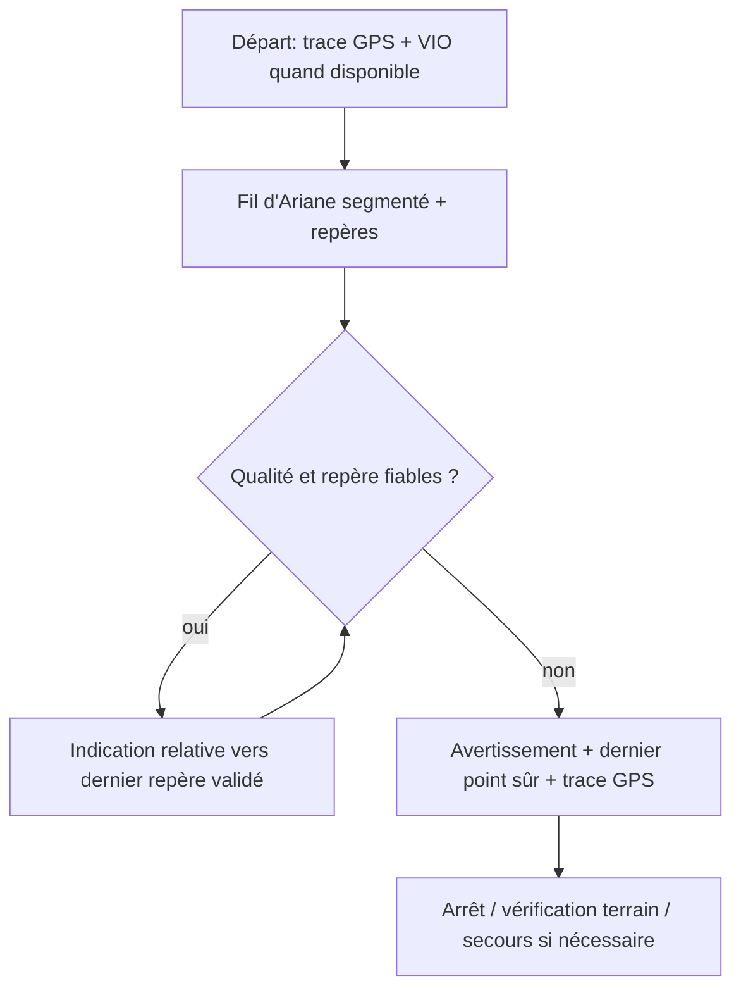

# VECTOR VIO — Atlas produit & architecture modulaire
> Brainstorm visuel • 18 octobre 2026 • **document de conception, pas fonctionnalités livrées**  
> Référence : branche `feature/slam-explorer`. État déduit des README, MODULES_AND_DATASETS, GPS_NAVIGATION, SPATIAL_EXPLORER et POWER_PROFILES.  
> Statuts : 🟢 présent dans le code/documenté · 🟠 partiel/à valider · ⚪ idée · 🔴 non démontré.

## 1. Carte des possibilités

## 2. État observé dans le dépôt

| Capacité | État | Limite concrète |
|---|---|---|
| ARCore caméra + IMU, poses métriques et odomètre | 🟢 | Précision non certifiée sur appareil ; ARCore est le moteur VIO, pas un SLAM maison. |
| Plans, points épars, tracé, POI manuels, carte 3D sauvegardée | 🟢 | Snapshot consultable ≠ carte de suivi ARCore rechargeable ; pas de carte dense. |
| Capture vidéo/IMU, SIM, CSV et exports | 🟠 | SIM n'est pas un estimateur général ; relecture ARCore et benchmark réel incomplets. |
| Import/export GPX, suivi GPS, marche écran éteint | 🟢 | GPS et carte locale AR ne sont pas fusionnés ; ambiguïtés possibles aux croisements. |
| Profils VIEW 5/15/30 et traitement visé à 30 poses/s | 🟢 | Fréquence réelle et gain batterie non garantis. |
| Interface moteur interchangeable et séparation par cas d'usage | 🔴 | MainActivity/SceneMapper dépendent encore d'ARCore ; pas de contrat commun. |
| Reconnaissance de rayons, navigation indoor persistante | ⚪ | Aucun pipeline sémantique ni localisation inter-session. |
| Retour au centimètre près / guidage sûr sous neige ou brouillard | 🔴 | **Ne jamais promettre** : dérive, pertes de suivi, obstacles, changements de scène. |

**Avis :** prototype fonctionnellement riche, mais architecture encore centrée sur une activité ARCore. La prochaine priorité n'est pas une nouvelle fonctionnalité spectaculaire : c'est un contrat de données spatial stable, la validation terrain et la séparation des modules. L'interface doit afficher la qualité du suivi et les trous de trajectoire.

## 3. Architecture cible (proposition)

### Contrats à stabiliser avant de refactoriser
- `PoseSample` : timestamp monotone, repère, position/orientation, source, segment, statut de tracking, qualité **inconnue si non fournie**.
- `SpatialFeature` : géométrie, type (plan/point/POI/rayon), source (mesuré/estimé/saisi), confiance, version et repère.
- `MapSession` : session UUID, repère local, segments non raccordés, métadonnées caméra, transformations et provenance.
- `RouteGraph` : nœuds/liaisons praticables, sens, obstacles et coûts ; **un nuage de points ne suffit pas** à définir un chemin.
- `FeatureModule` : permissions, entrées/sorties, stockage et écran déclarés ; ne pas créer des interfaces fictives avant d'extraire un vrai adapter ARCore.
- Séparer **acquisition / estimation / stockage / rendu / navigation / sémantique**. Aucun module métier ne doit manipuler directement `com.google.ar.core.Session`.

## 4. Scénario « Supermarché »

**MVP réaliste :** cartographier un seul magasin, enregistrer **manuellement** quelques rayons/produits en marchant, construire des liaisons praticables, ordonner la liste et permettre de corriger une localisation. **Phase 2 :** OCR des étiquettes, code-barres, classification visuelle des rayons avec consentement, fusion de visites et partage opt-in. Les prix et emplacements changent ; une base doit avoir date, magasin, fiabilité et corrections. Une carte ARCore sauvegardée ne permet pas aujourd'hui de se relocaliser automatiquement à la prochaine visite.

## 5. Scénario « Retour / Search & Rescue »

Trois modes distincts : **Retour sur ses pas** (tracé local, même session), **Itinéraire extérieur** (GPX + GPS + incertitude), **Secours** (export de trace, horodatage, dernière position fiable, partage volontaire). Une trace enregistrée n'est **pas** un couloir sûr : neige, brouillard, falaises, crevasses et obstacles peuvent changer. Pas de promesse centimétrique, de guidage fiable après perte de tracking, ni de remplacement de carte/boussole/GPS de secours. Le téléphone peut perdre caméra, batterie ou réseau. Prévoir un mode hors ligne et des alertes explicites.

## 6. Autres idées compatibles avec le même noyau
| Idée | Valeur | Pré-requis |
|---|---|---|
| Inventaire d'entrepôt / atelier | Retrouver matériel par zone | POI + carte persistante + recherche |
| Visite technique / inspection PV | Marquer défauts et exporter annotations | Photos/POI, géométrie et historique |
| Accessibilité indoor | Retrouver un trajet praticable | Graphe fiable, escaliers/ascenseurs, validation |
| Exploration de bâtiments | Annoter pièces et issues | Segmentation, fusion multi-sessions |
| Recherche VIO | Comparer ARCore et moteurs ouverts | Replay calibré, vérité terrain indépendante |

## 7. Décisions produit et ordre recommandé

| Phase | Travail | Critère de sortie |
|---|---|---|
| **P0 — vérité terrain** | Tests S21, marche/course, intérieur/extérieur, pertes de tracking, batterie/thermique | Rapports reproductibles, pas de précision inventée |
| **P1 — contrats** | Modèles Pose/Map/POI/Route, séparation adaptateur ARCore et UI ; tests de non-régression | Explorer fonctionne sans dépendance métier à ARCore |
| **P2 — cartes durables** | Formats versionnés, repères, segments, alignement GPS explicite, export/import | Carte consultable ; limites de relocalisation affichées |
| **P3 — Courses MVP** | Rayons saisis manuellement, plan 2D, graphe, optimisation d'ordre | Liste ordonnée sur un magasin test |
| **P4 — Retour MVP** | Breadcrumbs, état de fiabilité, GPX en secours, mode hors ligne | Tests de perte de tracking, aucune instruction trompeuse |
| **P5 — avancé** | Reconnaissance sémantique, relocalisation, multi-session, backend VIO alternatif | Évaluations indépendantes avant activation |

**Une application, plusieurs modes** pour l'instant : partage des permissions, cartes et composants, navigation par modules. Envisager plusieurs APK seulement si publics, permissions, distribution ou cadence de développement divergent fortement. Éviter de fragmenter prématurément.

## 8. Backlog de décisions ouvertes
- [ ] Définir une **carte commune** : topologie navigable vs géométrie vs sémantique ; versions et repères.
- [ ] Définir les politiques de **confiance** : perte de tracking, alignement GPS, marqueurs estimés, parcours discontinu.
- [ ] Tester relocalisation inter-session : aujourd'hui **non disponible** ; choisir moteur/stratégie après benchmark.
- [ ] Choisir UX des rayons : bouton, scan, voix, OCR ; privilégier la saisie la plus rapide.
- [ ] Définir vie privée : vidéo en magasin, passants, consentement, partage et suppression locale.
- [ ] Écrire des tests de contrat entre moteur, carte, graphe et UI.
- [ ] Évaluer architecture multi-modules Gradle **après** extraction d'une première frontière réelle.

### Documents existants à conserver comme sources de vérité
[Modules et jeux de données](MODULES_AND_DATASETS.md) · [Architecture](ARCHITECTURE.md) · [Spatial Explorer](SPATIAL_EXPLORER.md) · [GPS](GPS_NAVIGATION.md) · [Énergie](POWER_PROFILES.md) · [Validation](VALIDATION.md)

---
*Ce document est un atlas d'idées et une proposition d'architecture. Il ne prétend ni implémenter ces modules ni valider leur sûreté.*
