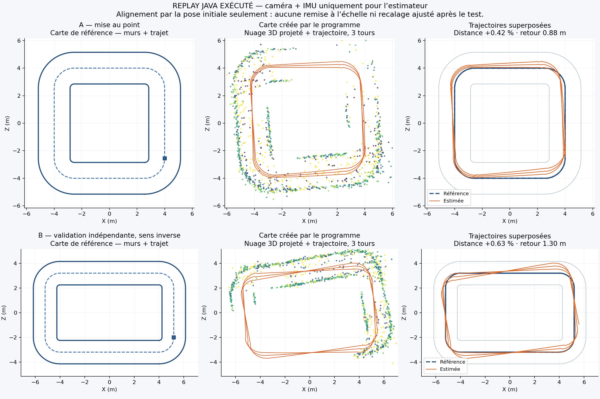
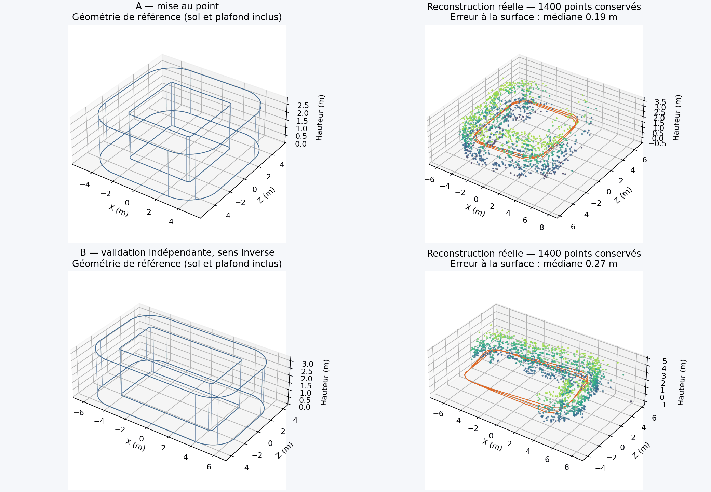
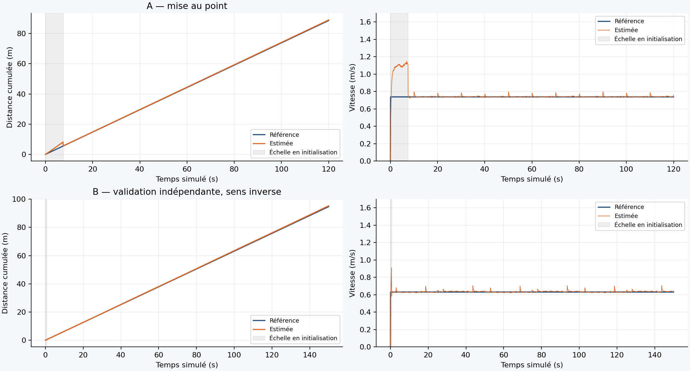

# Executed replay comparison — 2026-10-17

The trajectory, point-cloud and reconstructed-path CSVs are losslessly gzip-compressed (`*.csv.gz`); `gzip -dk scene-a/*.gz` restores ordinary CSVs.

This directory contains measured outputs from the **actual Java app renderer and estimator**, run headlessly. It is not an Android device/emulator UI test and not a real-world dataset benchmark.

## Reproduce

```bash
./tools/simulation/run.sh deliverables/scene-a 3 default 15 1
# Estimator frozen before creating/evaluating this second scene:
./tools/simulation/run.sh deliverables/scene-b 3 reverse 15 1
python3 tools/simulation/report.py deliverables/scene-a deliverables/scene-b docs/simulation-validation --check
```

Java 17 (including `jdk.compiler`) is sufficient for replay. Plotting uses Python, NumPy and Matplotlib. Camera pixels at 480×360 and synchronized synthetic IMU samples are the only estimator inputs, alongside known camera calibration. Ground-truth geometry/poses are used only in rendering and evaluation.

## Anti-overfit procedure

- Scene A: 8×8 m centerline extents, 1.45 m corner radius, 2.30 m corridor width, 2.85 m ceiling, 40 seconds per lap.
- Freeze `SyntheticVision.java`: SHA-256 `a489c1501e99f460338f38e53fb39a971be28d0c9d5f4b84f5b8d08f1b1028a5`.
- Scene B added **after freezing**: 10.4×6.4 m centerline extents, 1.20 m radius, 1.90 m width, 3.20 m ceiling, different texture seed, reverse traversal, 50 seconds per lap and different speed.
- Three consecutive laps in each scene, with no map reset at lap boundaries. The estimator file hash was rechecked after B. No tuning on B.
- Initial-pose alignment only. No fitted scale or final trajectory registration is used in evaluation. Internal metric initialization from measured turning acceleration is part of the estimator, not a ground-truth correction.

## Results

| Three continuous laps | Scene A | Scene B, held out |
|---|---:|---:|
| Reference distance | 88.600 m | 94.719 m |
| Estimated distance | 88.969 m | 95.314 m |
| Distance error | +0.417% | +0.628% |
| Final return error | 0.879 m | 1.298 m |
| Online position RMSE | 0.555 m | 0.677 m |
| Reference mean speed after scale initialization | 0.738 m/s | 0.631 m/s |
| Estimated mean speed after initialization | 0.741 m/s | 0.635 m/s |
| Speed RMSE after initialization | 0.0076 m/s | 0.0095 m/s |
| Map point nearest-surface error, median / p90 | 0.187 / 0.471 m | 0.268 / 0.653 m |
| Retained sparse points | 1,400 | 1,400 |

The original estimator, replayed on **the same final Scene A inputs**, accumulated 128.682 m instead of 88.600 m (+45.24%), with 6.525 m final return error. Earlier exploratory runs used different camera jitter; their scores are not the fair comparison reported here.





## Practical limits

The path is substantially closer to the reference, and the sparse cloud follows much of the corridor. It is **not** a complete watertight reconstruction: points are noisy, spatial coverage is incomplete, and the bounded map discards older points. There is no learned loop closure or global bundle adjustment; accumulated drift remains visible over three laps. Nearest-surface error does not measure completeness.

Scale/velocity initialization assumes visually confirmed **forward planar motion during turns**. Smooth synthetic motion with good texture is favorable; this is not a general arbitrary-phone-motion VIO estimator. These two tests do not prove real-world robustness. See [the real-data validation decision](../REAL_DATA_VALIDATION.md) for EuRoC, TUM VI, ADVIO, ORB-SLAM3 and ARCore replay.
